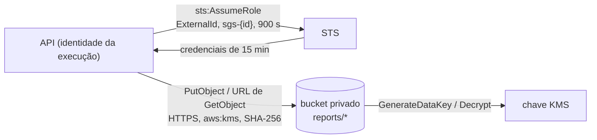

# Exemplo de IAM e STS na AWS (relatórios)

> Plataforma de Governança de Dados de Saúde · SESAU Recife · Grupo 01
> Spec 005, tarefa T7. Fonte: `specs/005-exportacao-relatorios-s3/design.md` § Ambiente de demonstração, "AWS real" (G1). Decisão: ADR-0005.
> Status: exemplo, aguarda a revisão de um integrante (critério da T7). Requisitos: R2.1 e R2.3.

Uso opcional, só se houver conta AWS. Sem conta, a demonstração usa o SeaweedFS do compose com o mesmo código (ADR-0005), e o caminho de `prod` fica provado pelo `moto`, pela R2.9 e por este documento (design § Riscos).

Todos os valores entre `<...>` são marcadores. Nenhum id de conta, chave ou segredo real entra neste repositório (`steering/security.md`).

| Marcador | O que é |
|---|---|
| `<ID_DA_CONTA>` | id da conta AWS (12 dígitos) |
| `<REGIAO>` | região do bucket e da chave KMS (vai em `S3_REGION`) |
| `<BUCKET>` | nome do bucket dos relatórios (vai em `S3_BUCKET`) |
| `<ID_DA_CHAVE_KMS>` | id da chave KMS; o ARN completo vai em `S3_KMS_KEY_ID` |
| `<PAPEL_DA_EXECUCAO>` | papel da identidade em que a API roda (instância, tarefa ou *web identity*) |
| `<EXTERNAL_ID>` | valor do `ExternalId` combinado entre a API e a confiança do papel (vai em `S3_EXTERNAL_ID`) |

## 1. Visão geral



1. A API roda com a identidade do ambiente de execução, que só pode assumir o papel `sgs-report-writer` (§ 5). Nunca usa chave fixa (R2.2, R2.9).
2. Antes de cada envio e de cada URL de download, a API chama `sts:AssumeRole` com `ExternalId`, `RoleSessionName=sgs-{id do usuário}` e `DurationSeconds=900` (R2.1; design D005-2).
3. Com essas credenciais, grava em `reports/...` com `ServerSideEncryption=aws:kms`, a chave configurada e o checksum SHA-256 (R2.3), ou gera a URL pré-assinada de 5 minutos.
4. O bucket recusa o que chega sem TLS ou sem `aws:kms` (§ 3).

## 2. Bucket

- **Privado**, com as quatro opções de *Block Public Access* ligadas:

  ```json
  {
    "BlockPublicAcls": true,
    "IgnorePublicAcls": true,
    "BlockPublicPolicy": true,
    "RestrictPublicBuckets": true
  }
  ```

- **Versionamento** ligado (`Status: Enabled`). A API remove exatamente a versão gravada quando a conferência da R2.8 falha (`DeleteObjectVersion`), sem deixar a versão ruim atrás de um *delete marker* (design § Adaptador S3, "Remoção").
- **Ciclo de vida de 90 dias** em `reports/` (guarda de 90 dias do G1; `REPORT_RETENTION_DAYS=90`):

  ```json
  {
    "Rules": [
      {
        "ID": "sgs-relatorios-90-dias",
        "Status": "Enabled",
        "Filter": { "Prefix": "reports/" },
        "Expiration": { "Days": 90 }
      }
    ]
  }
  ```

  O que acontece com as versões anteriores e os *delete markers* depois da expiração está em § 8.

## 3. Política do bucket

Dois `Deny`, como no design: sem `aws:SecureTransport` e `PutObject` sem `aws:kms`. O segundo vem em duas declarações, para cobrir o cabeçalho com outro valor e o cabeçalho ausente.

```json
{
  "Version": "2012-10-17",
  "Statement": [
    {
      "Sid": "NegaSemTLS",
      "Effect": "Deny",
      "Principal": "*",
      "Action": "s3:*",
      "Resource": [
        "arn:aws:s3:::<BUCKET>",
        "arn:aws:s3:::<BUCKET>/*"
      ],
      "Condition": { "Bool": { "aws:SecureTransport": "false" } }
    },
    {
      "Sid": "NegaPutSemKmsValorErrado",
      "Effect": "Deny",
      "Principal": "*",
      "Action": "s3:PutObject",
      "Resource": "arn:aws:s3:::<BUCKET>/*",
      "Condition": {
        "StringNotEquals": { "s3:x-amz-server-side-encryption": "aws:kms" }
      }
    },
    {
      "Sid": "NegaPutSemKmsCabecalhoAusente",
      "Effect": "Deny",
      "Principal": "*",
      "Action": "s3:PutObject",
      "Resource": "arn:aws:s3:::<BUCKET>/*",
      "Condition": {
        "Null": { "s3:x-amz-server-side-encryption": "true" }
      }
    }
  ]
}
```

A política do bucket é a barreira do lado do armazenamento. A API confere também a resposta do `PutObject` (SSE `aws:kms`, `SSEKMSKeyId` igual ao ARN configurado e `ChecksumSHA256` igual ao enviado) e remove a versão se não conferir (R2.8).

## 4. Chave KMS

- Chave do KMS usada só para os relatórios, na mesma região do bucket.
- A API recebe o **ARN** da chave em `S3_KMS_KEY_ID` (`arn:aws:kms:<REGIAO>:<ID_DA_CONTA>:key/<ID_DA_CHAVE_KMS>`), não alias nem id: a resposta do `PutObject` traz o ARN, e a conferência da R2.8 compara os dois sem chamar o KMS (design D005-5).
- O papel `sgs-report-writer` recebe `kms:GenerateDataKey` (para gravar) e `kms:Decrypt` (para o `GetObject` da URL de download) nessa chave (§ 5). A política da própria chave está em § 8.

## 5. Papel `sgs-report-writer`

### 5.1. Permissões

Só `PutObject`, `GetObject` e `DeleteObjectVersion` em `reports/*`, e as duas ações de KMS na chave.

```json
{
  "Version": "2012-10-17",
  "Statement": [
    {
      "Sid": "ObjetosDosRelatorios",
      "Effect": "Allow",
      "Action": [
        "s3:PutObject",
        "s3:GetObject",
        "s3:DeleteObjectVersion"
      ],
      "Resource": "arn:aws:s3:::<BUCKET>/reports/*"
    },
    {
      "Sid": "ChaveDosRelatorios",
      "Effect": "Allow",
      "Action": [
        "kms:GenerateDataKey",
        "kms:Decrypt"
      ],
      "Resource": "arn:aws:kms:<REGIAO>:<ID_DA_CONTA>:key/<ID_DA_CHAVE_KMS>"
    }
  ]
}
```

Sem `s3:ListBucket`: a API sempre sabe a chave do objeto (R2.4), e o `GetObject` de uma chave inexistente responde 403 em vez de 404. A API não depende disso, porque confere o pedido no banco antes de gerar a URL (design § Download).

### 5.2. Confiança

Só a identidade da execução pode assumir o papel, e só com o `ExternalId` combinado.

```json
{
  "Version": "2012-10-17",
  "Statement": [
    {
      "Sid": "SoAIdentidadeDaApiComExternalId",
      "Effect": "Allow",
      "Principal": {
        "AWS": "arn:aws:iam::<ID_DA_CONTA>:role/<PAPEL_DA_EXECUCAO>"
      },
      "Action": "sts:AssumeRole",
      "Condition": {
        "StringEquals": { "sts:ExternalId": "<EXTERNAL_ID>" }
      }
    }
  ]
}
```

A sessão pedida pela API dura 900 s (15 min, R2.1), o mínimo do STS, dentro da duração máxima padrão do papel (1 h).

## 6. Identidade da execução

A identidade em que a API roda (`<PAPEL_DA_EXECUCAO>`) tem `sts:AssumeRole` **só** no papel `sgs-report-writer`, e nenhuma permissão direta no bucket nem na chave.

```json
{
  "Version": "2012-10-17",
  "Statement": [
    {
      "Sid": "SoAssumirOPapelDosRelatorios",
      "Effect": "Allow",
      "Action": "sts:AssumeRole",
      "Resource": "arn:aws:iam::<ID_DA_CONTA>:role/sgs-report-writer"
    }
  ]
}
```

O cliente `sts` do boto3 pega essa identidade da cadeia padrão do ambiente (papel da instância ou da tarefa, ou *web identity*). Em `prod`, a subida recusa `AWS_ACCESS_KEY_ID`, `AWS_SECRET_ACCESS_KEY`, `AWS_SESSION_TOKEN`, `AWS_PROFILE` e as `S3_ACCESS_KEY_ID`/`S3_SECRET_ACCESS_KEY` (R2.9).

## 7. Configuração da API em `prod`

Variáveis de design § Configuração. Os valores reais ficam no ambiente de execução, nunca no repositório.

| Variável | Valor em `prod` na AWS |
|---|---|
| `APP_ENV` | `prod` |
| `S3_BUCKET` | `<BUCKET>` |
| `S3_REGION` | `<REGIAO>` |
| `S3_ENDPOINT_URL`, `S3_PUBLIC_ENDPOINT_URL` | vazios: valem os endereços HTTPS padrão da AWS (design § Adaptador S3, "Dois endereços") |
| `S3_CA_FILE` | vazio: CAs do sistema |
| `S3_ADDRESSING_STYLE` | `virtual` (padrão) |
| `S3_ASSUME_ROLE_ARN` | `arn:aws:iam::<ID_DA_CONTA>:role/sgs-report-writer` |
| `S3_EXTERNAL_ID` | `<EXTERNAL_ID>` |
| `S3_SSE` | `aws:kms` (`prod` recusa outro valor) |
| `S3_KMS_KEY_ID` | `arn:aws:kms:<REGIAO>:<ID_DA_CONTA>:key/<ID_DA_CHAVE_KMS>` |
| `S3_ACCESS_KEY_ID`, `S3_SECRET_ACCESS_KEY`, `AWS_ACCESS_KEY_ID`, `AWS_SECRET_ACCESS_KEY`, `AWS_SESSION_TOKEN`, `AWS_PROFILE` | ausentes (a subida recusa, R2.9) |

## 8. Pontos em aberto

O design não decide os pontos abaixo. Ficam para quem montar a conta, com a decisão registrada na spec 005 antes de usar.

1. **Versões anteriores no ciclo de vida.** Num bucket versionado, `Expiration` cria um *delete marker* e mantém a versão como anterior. O design pede "ciclo de vida de 90 dias em `reports/`" e não diz se as versões anteriores e os *delete markers* órfãos também expiram (`NoncurrentVersionExpiration`, `ExpiredObjectDeleteMarker`).
2. **Política da chave KMS.** O design dá ao papel `kms:GenerateDataKey` e `kms:Decrypt` na política IAM, mas não descreve a política da chave. Na AWS, a política IAM só vale se a política da chave delegar ao IAM da conta ou citar o papel.
3. **Criptografia padrão do bucket.** O design exige `aws:kms` pela política do bucket e pelo cabeçalho do envio, e não diz se o bucket também deve ter a criptografia padrão em `aws:kms` com a mesma chave, nem se usa *S3 Bucket Key*.
4. **Política do bucket presa à chave.** O `Deny` do design confere só `aws:kms`, não qual chave. A API confere a chave na resposta (R2.8); exigir também `s3:x-amz-server-side-encryption-aws-kms-key-id` na política não está no design.
5. **Tipo da identidade da execução.** O design aceita papel da instância, da tarefa ou *web identity*; a escolha depende de onde a API vai rodar, que não está definido.
6. **Guarda configurável e regra fixa.** `REPORT_RETENTION_DAYS` aceita de 1 a 3650 dias, e a regra do bucket está em 90. Se o valor mudar, a regra tem de mudar junto; o design não diz quem garante isso.
7. **Conta disponível.** Ainda não há conta AWS confirmada (requirements § Perguntas em aberto). Antes de usar, conferir se a conta permite criar papel IAM e chave KMS, o que contas de laboratório costumam restringir.
