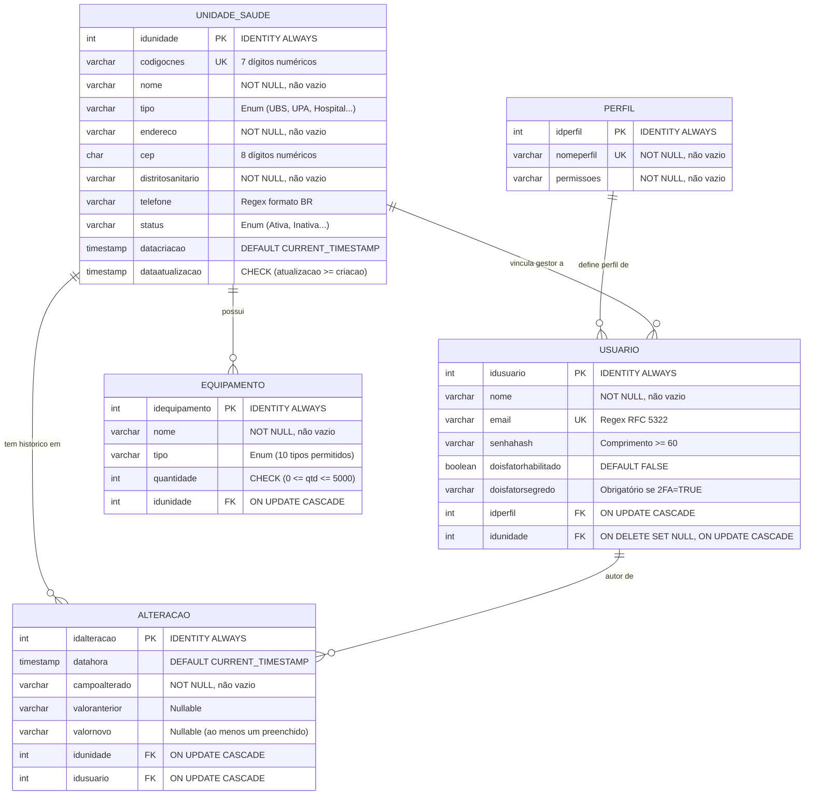

# Relatório Técnico: Integração do Banco de Dados PostgreSQL à API SGS

**Projeto:** Plataforma de Governança de Dados de Saúde da Secretaria de Saúde do Recife  
**Equipe:** Grupo 01 (CS018, CESAR School)  
**Etapa:** Etapa 02 - Modelagem Relacional e Integração Backend  
**Branch:** `feat/002-autenticacao`  
**Data:** 26 de Outubro de 2026  

---

## 1. Visão Geral e Objetivos

O objetivo desta entrega foi integrar a base de dados relacional **PostgreSQL 17** à API existente (**FastAPI/Python**), mapeando com fidelidade cirúrgica as **5 tabelas** desenvolvidas para a Etapa 02 da disciplina de Banco de Dados:
1. `PERFIL`
2. `UNIDADE_SAUDE`
3. `USUARIO`
4. `EQUIPAMENTO`
5. `ALTERACAO`

A implementação seguiu rigorosamente os padrões de **Clean Architecture / Ports & Adapters** e **Spec-Driven Development (SDD)** do repositório, garantindo conformidade com:
- Validação estrita de tipos com **Mypy**.
- Linting e formatação com **Ruff**.
- Contratos de arquitetura modular com **Import-Linter**.
- Testes unitários rápidos e testes de integração com PostgreSQL real via **Testcontainers / Podman**.

---

## 2. Estrutura Relacional e Migrações (Alembic)

A migração oficial foi versionada em `migrations/versions/0002_etapa2_tabelas.py`, encadeada diretamente a partir da migração base (`0001_base.py`).

### 2.1 Especificação das Tabelas



### 2.2 Compatibilidade de Identificadores no PostgreSQL
No PostgreSQL, identificadores não cotados (`PERFIL`, `NomePerfil`) são registrados internamente no catálogo em minúsculas (`perfil`, `nomeperfil`), permitindo que consultas SQL escritas tanto em maiúsculas (`SELECT * FROM PERFIL`) quanto em minúsculas (`SELECT * FROM perfil`) funcionem de forma idêntica.
- No SQLAlchemy Core e no Alembic, as tabelas foram declaradas em minúsculas, assegurando **divergência zero** no comando `alembic autogenerate` e total compatibilidade com o script de inserção original fornecido.

---

## 3. Arquitetura de Software e Módulos Implementados

O código foi distribuído entre os módulos de negócio de acordo com o `steering/structure.md`:

```
src/
├── core/
│   ├── config.py                 # Validação de DATABASE_URL e credenciais
│   ├── db.py                     # Metadata SQLAlchemy, AsyncEngine e migrações
│   └── errors.py                 # DomainValidationError e FieldError
├── modules/
│   ├── identity/                 # Módulo de Autenticação e Perfis
│   │   ├── domain/
│   │   │   ├── perfil.py         # Entidade Perfil (validação de regras)
│   │   │   └── usuario.py        # Entidade Usuario (regras de e-mail, hash e 2FA)
│   │   └── infrastructure/
│   │       ├── tables.py         # Table("perfil") e Table("usuario")
│   │       └── repository.py     # SqlPerfilRepository e SqlUsuarioRepository
│   ├── registry/                 # Módulo de Cadastros Governamentais
│   │   ├── domain/
│   │   │   ├── unidade.py        # Entidade UnidadeSaude (CNES, CEP, Enums)
│   │   │   └── equipamento.py    # Entidade Equipamento (tipos, faixas)
│   │   └── infrastructure/
│   │       ├── tables.py         # Table("unidade_saude") e Table("equipamento")
│   │       └── repository.py     # SqlUnidadeSaudeRepository e SqlEquipamentoRepository
│   └── audit/                    # Módulo de Auditoria e Histórico
│       ├── domain/
│       │   └── alteracao.py      # Entidade Alteracao (histórico de mutações)
│       └── infrastructure/
│           ├── tables.py         # Table("alteracao")
│           └── repository.py     # SqlAlteracaoRepository
└── tools/
    └── seed_db.py                # Runner de inicialização e seed do banco
```

---

## 4. Matriz de Integridade (Dupla Camada de Defesa)

Seguindo o princípio da defesa em profundidade, cada restrição é validada **em código no Domínio** (gerando erros legíveis ao cliente HTTP) e **no Banco de Dados** (garantindo consistência ácida transacional):

| Campo / Regra | Validação no Domínio Python (`DomainValidationError`) | Validação no Banco de Dados (`PostgreSQL`) |
|---|---|---|
| **Chave Primária** | Atribuída pelo banco no retorno do `insert().returning()` | `INTEGER GENERATED ALWAYS AS IDENTITY PRIMARY KEY` |
| **CNES (7 dígitos)** | Regex `^[0-9]{7}$` | `CHECK (codigocnes ~ '^[0-9]{7}$')` |
| **CEP (8 dígitos)** | Regex `^[0-9]{8}$` | `CHECK (cep ~ '^[0-9]{8}$')` |
| **E-mail do Usuário** | Regex RFC 5322 em minúsculo/maiúsculo | `CHECK (email ~* '^[A-Za-z0-9._%+\\-]+@[A-Za-z0-9.\\-]+\\.[A-Za-z]{2,}$')` |
| **Telefone da Unidade** | Regex `^\(?[0-9]{2,3}\)?[ ]?[0-9]{4,5}-?[0-9]{4}$` | `CHECK (telefone IS NULL OR telefone ~ '...')` |
| **Hash de Senha** | Comprimento mínimo de 60 caracteres | `CHECK (length(senhahash) >= 60)` |
| **Segundo Fator (2FA)** | Segredo obrigatório se `dois_fator_habilitado == True` | `CHECK ((doisfatorhabilitado = false) OR (doisfatorsegredo IS NOT NULL AND btrim(doisfatorsegredo) <> ''))` |
| **Tipo de Unidade** | Enum: UBS, UPA, Hospital, Laboratório, Posto/Centro | `CHECK (tipo IN ('UBS', 'UPA', 'Hospital', ...))` |
| **Status de Unidade** | Enum: Ativa, Inativa, Em reforma, Suspensa | `CHECK (status IN ('Ativa', 'Inativa', 'Em reforma', 'Suspensa'))` |
| **Datas de Unidade** | `data_atualizacao >= data_criacao` | `CHECK (dataatualizacao >= datacriacao)` |
| **Quantidade Equip.** | Inteiro no intervalo $[0, 5000]$ | `CHECK (quantidade >= 0 AND quantidade <= 5000)` |
| **Tipos de Equipamento** | Restrito aos 10 tipos homologados | `CHECK (tipo IN ('Monitor...', 'Respirador', ...))` |
| **Valores de Alteração**| Não permite ambos nulos | `CHECK (valoranterior IS NOT NULL OR valornovo IS NOT NULL)` |
| **FK Unidade em Usuário**| Integridade via repositório | `ON UPDATE CASCADE, ON DELETE SET NULL` |
| **FKs de Equipamento/Alt**| Integridade via repositório | `ON UPDATE CASCADE` |

---

## 5. Fluxo de Inicialização e Seed de Dados

Para viabilizar testes manuais, homologação e cenários de integração contínua:
1. **Recurso de Seed:** O arquivo original `2_SQL_Insercao_Dados.sql` foi versionado no projeto em `src/resources/seeds/2_SQL_Insercao_Dados.sql`.
2. **Script Runner (`src/tools/seed_db.py`):**
   - Executa o script SQL em uma transação assíncrona única utilizando o driver de conexão de baixo nível do `asyncpg` (`raw_conn.driver_connection.execute`), permitindo parsing de scripts complexos em milissegundos.
   - Realiza consulta pós-execução e exibe contagem consolidada de tuplas por tabela.
3. **Atalho no Makefile:**
   ```bash
   make seed
   ```
   Saída esperada:
   ```
   Iniciando seed do banco de dados a partir de: src/resources/seeds/2_SQL_Insercao_Dados.sql...
   Seed concluído com sucesso! Registros por tabela:
     - perfil: 30 registros
     - unidade_saude: 30 registros
     - usuario: 30 registros
     - equipamento: 30 registros
     - alteracao: 31 registros
   Total: 151 registros inseridos.
   ```

---

## 6. Resultados de Testes e Garantia de Qualidade

A esteira de checagens automatizadas foi executada localmente contra um contêiner PostgreSQL 17 gerenciado via **Podman / Testcontainers**:

```bash
$ make check
```

### 6.1 Resultados por Etapa:
- **Ruff Linter:** 100% aprovado (`All checks passed!`).
- **Ruff Formatter:** 65 arquivos no formato canônico do projeto.
- **Mypy (Strict Mode):** Tipagem estática 100% válida em todos os 65 arquivos fonte (`Success: no issues found`).
- **Import-Linter:** Todos os 6 contratos de independência de camadas e isolamento de domínio mantidos (`Contracts: 6 kept, 0 broken`).
- **Pytest:** **151 testes executados e aprovados** em 8.09 segundos:
  - 36 testes unitários específicos das novas entidades de domínio.
  - 6 testes de integração de ponta a ponta cobrindo:
    1. Criação das 5 tabelas no banco de dados.
    2. Execução do seed de 151 tuplas.
    3. Operações CRUD via repositórios assíncronos.
    4. Propagação de integridade referencial `ON UPDATE CASCADE`.
    5. Propagação de integridade referencial `ON DELETE SET NULL`.
    6. Rejeição ativa de Check Constraints no PostgreSQL.
  - 1 teste de sincronismo estrito do Alembic (`test_migracoes_e_tabelas_do_codigo_nao_divergem`).

---

## 7. Relação Completa dos Arquivos

### Arquivos Criados:
- `migrations/versions/0002_etapa2_tabelas.py`
- `src/modules/identity/__init__.py`
- `src/modules/identity/domain/__init__.py`
- `src/modules/identity/domain/perfil.py`
- `src/modules/identity/domain/usuario.py`
- `src/modules/identity/infrastructure/__init__.py`
- `src/modules/identity/infrastructure/tables.py`
- `src/modules/identity/infrastructure/repository.py`
- `src/modules/registry/__init__.py`
- `src/modules/registry/domain/__init__.py`
- `src/modules/registry/domain/unidade.py`
- `src/modules/registry/domain/equipamento.py`
- `src/modules/registry/infrastructure/__init__.py`
- `src/modules/registry/infrastructure/tables.py`
- `src/modules/registry/infrastructure/repository.py`
- `src/modules/audit/domain/alteracao.py`
- `src/resources/seeds/1_SQL_Criacao_Tabelas.sql`
- `src/resources/seeds/2_SQL_Insercao_Dados.sql`
- `src/tools/seed_db.py`
- `tests/unit/identity/test_domain_identity.py`
- `tests/unit/registry/test_domain_registry.py`
- `tests/unit/audit/test_domain_alteracao.py`
- `tests/integration/test_etapa2_banco.py`

### Arquivos Modificados:
- `Makefile` (inclusão do comando `seed`)
- `migrations/env.py` (registro das tabelas de `identity` e `registry` no target metadata)
- `src/modules/audit/infrastructure/tables.py` (inclusão da tabela `alteracao`)
- `src/modules/audit/infrastructure/repository.py` (inclusão do `SqlAlteracaoRepository`)
- `steering/structure.md` (formalização das 5 tabelas da Etapa 02 no steering do repositório)
- `tests/integration/test_migracoes_sincronizadas.py` (registro dos novos módulos na asserção de metadados)
